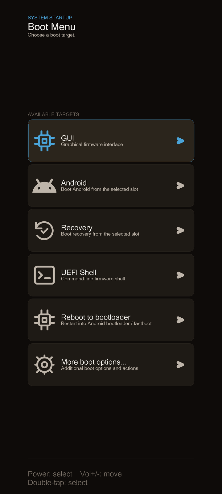
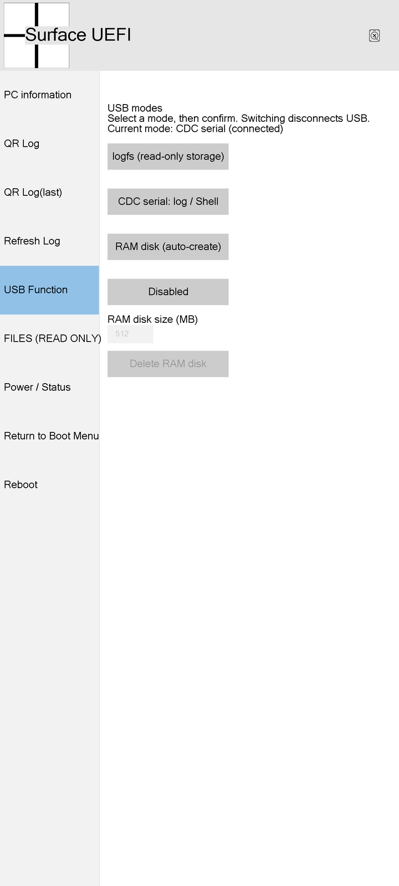
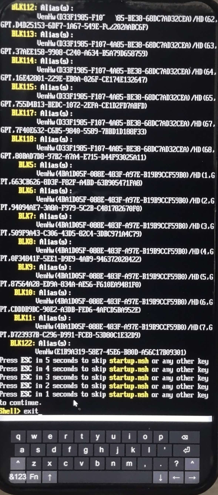

# mu_aloha_SM8650_shennong

**中文** | [**English**](README_EN.md)

> **借鉴或使用本项目时，请在项目的显眼位置注明本项目和上游来源。**
> 具体要求见 [项目使用](#项目使用)。

**Xiaomi 14 Pro**（shennong / SM8650）的 Project Mu UEFI 移植：SM8650 overlay 源码、一键编译脚本、可启动镜像 及设备树。项目旨在为 Xiaomi 14 pro（shennong） 机型的相关 Windows on arm 及其他系统的移植项目（如UniXNU）提供力所能及的帮助。

- 开发快照：2026-11-03，DEBUG / ShennongNoSb
- 镜像：`Build/ShennongPkg/xiaomi-shennong.img`，2,785,280 字节
  SHA256 `c55947484c7c9635df6791e6ba2728a970531a267bd822934ce7a8824d29593e`
- 基线：Project Mu Aloha `dev/update/mu202502`

## 界面

<table>
<tr>
<td></td>
<td></td>
</tr>
<tr>
<td align="center">Boot Menu —— 5 秒无操作自动进入 GUI，可退出至设备模式</td>
<td align="center">USB Function —— 四种模式可切换</td>
</tr>
</table>



**UEFI Shell + 屏幕键盘** —— `alias` 输出的块设备列表，以及底部的软键盘。

## 当前情况

当前镜像的实机记录见本地交付目录。

| 能力 | 当前结果 |
|---|---|
| 屏幕 / 触摸 / OSK | 可用：1440×3200 帧缓冲、GUI 和屏幕键盘 |
| CDC / cdcshell | 可用：日志、硬件测试、Shell、文件上传和 EFI 启动命令 |
| RAM disk | 64..8192 MiB，分配失败会明确报错；64 / 128 MiB 实机精确分配通过，8 GiB 实机分配未验收 |
| CDC 上传 / Shell | 98 字节 NSH、131333 字节多窗口文件 CRC 回读与 NSH 执行通过；33280 字节 ARM64 EFI 上传并启动返回通过 |
| USB MSC | 共享 RAM 已在 Windows 挂载，文件读取校验和定时回 CDC 后回读通过。 |
| USB 热拔插 | 多次真实 CDC 拔插后自动恢复，含日志接收中断；原文件 CRC 保留与再次切换通过。大文件替换上传中拔线的实机验收尚未捕获。 |
| UFS | 原厂 LUN/GPT 读取、FAT 浏览；非加密 ext4 只读驱动已集成，保持普通存储写/擦除保护 |
| RPMB | 原始响应只读成功；类型、结果、地址、nonce、前后计数器核对，MAC 未认证；无写/密钥/解锁接口 |
| 震动 | 用户确认明显震动；TEST 独立页面，时长与强度滑动条，DIRECT_PLAY gain 映射 |
| 闪光灯 | 用户确认发光；双通道短脉冲测试、关闭与配置恢复 |
| ACPI | 实机 15 张表、关联与适用 checksum 核对，8 CPU；WinPE 平台适配未完成 |
| ARM64 WinPE | 精简 ARM64 PE 完整目录上传与 WIM CRC 已通过；两次 boot 指令接受后 CDC 断开，重试时用户看到黑屏，电脑端随后重新枚举为 Android ADB。PE 启动未成功，重启原因待定位。 |
| SMC / TZ | 普通 SMC、QSEE 版本、PAS 能力及 Keymaster 句柄查询；安全应用业务与子系统启动未完成 |
| WiFi / 蓝牙 | TEST/CDC 列表与 provider 状态可用；真实 AP / BLE 扫描后端缺失 |
| GPS / 陀螺仪 / 加速度 | 固件与平台依赖查询可用，定位和实时采样未完成 |
| 亮度 | 可查询 DCS provider；当前 provider 缺失，调节未完成 |
| 电池 / 充电 | 部分 getter 可用，电量、温度与充电控制未完成 |
| 相机 / 麦克风 / 扬声器 / GPU | 业务驱动未完成 |

USB 只走 stock 硬件链，原厂 UsbInitDxe、UsbfnDwc3Dxe、UsbDeviceDxe 未修改；旧非 stock 路径已移除。构建保留源码锁和镜像来源校验。

## CDC 与共享 RAM

CDC、USB Function 和本地文件系统共用同一块 RAM，不复制盘面。上传时独占 RAM，禁止切换或释放；MSC 接管时撤销本地挂载，归还后恢复本地只读访问。同容量 create 复用原盘，改变容量需要先 release。

固件与客户端默认 CDC line coding 为 3,000,000 8N1，客户端可用 `--baud 115200` 覆盖。baud 配置本身不限制这条 USB 数据路径；文件接收按剩余窗口批量提交，单次最大 64 KiB，末窗补零最多 1023 字节，仍校验 CRC 并在断线时取消未提交替换。客户端按已知长度读取每个 64 KiB 窗口的 ACK，避免等待 64 KiB 接收缓冲填满；普通命令和长正文沿用原接收路径。相同固件交替上传 4 MiB，旧客户端约 0.49 MiB/s，新客户端约 0.68 MiB/s，提升 40%，CRC 与完整日志帧通过。344.1 MiB WIM 实测 256.4 秒，平均 1.34 MiB/s，CRC 回读通过。页面上传期间使用最多 16 次 / 4 ms 的应用事件服务，并在页面等待中每 1 ms 服务；上传结束或取消后恢复正常等待。USB 驱动二进制与 30 项源码锁保持不变。

正常停止后使用原厂 Stop/StartEx 流程，仅在 halt 未确认时尝试原厂初始化；停止失败保留 DMA 缓冲和 RAM。同模式 CDC 停止/重启与共享文件 CRC 回读已通过。

切换从排队开始禁止其他切换、RAM 大小修改和释放。TEST 显示 switching 状态；驱动对重入返回 Already Started。回切先等待当前控制/BOT 事务完成，最多 5 秒；成功、拔线、超时和停止失败均完成收尾并释放切换锁。停止失败时保留 DMA 缓冲，后续重连或再次请求可重试。CDC 检测实际线缆下降沿，取消会话，并在 pump 外经过 200 ms 后走原厂 Stop/StartEx；普通总线 reset 不触发这条重建。多次真实 CDC 拔插后自动恢复，含日志接收中断；原文件 CRC 保留与再次切换通过。大文件替换上传中拔线的实机验收尚未捕获。

当前 USB 上层候选与 stock 硬件链按本页镜像及源码锁固定，后续平台推进沿用这个版本。

EFI 启动路径会把 Shell 启动前、返回后及 Shell 加载失败时的日志写入现有受限 logfs 日志区；重启后可用 `logcat-last` 读回。3072 字节 ARM64 EFI 的执行标记、返回与冷重启后 154821 字节旧快照 CRC 已通过。当前镜像只追加 FrontPage 的启动日志保存点；上传性能和 PE 失败记录来自前一候选，PE 重启原因仍待定位。

```text
ramdisk create 64
ramdisk info
ramdisk hash EFI/BOOT/BOOTAA64.EFI
shell map -r
shell FSx:\path\script.nsh
boot FSx:\EFI\BOOT\BOOTAA64.EFI
usb ramdisk 60
usb cdc
ramdisk release
rpmb-info
rpmb-read 0 1
test platform
test devices
test wireless-scan
test bluetooth
test sensors
test brightness-status
haptic level 500 75 direct
```

```bash
python tools/cdc-control.py --port COM20 --upload path/to/file --dest EFI/BOOT/BOOTAA64.EFI
python tools/cdc-control.py --port COM20 --upload-dir path/to/pe/media
python tools/cdc-console.py --port COM20
```

`FSx` 从 `shell map -r` 查找，不能固定盘符。`boot` 只接受单个映射 `.efi` 路径，ACK 后启动并使用真实控制台；客户端保持串口等待返回，断连或未观察到返回会明确报告。NSH 使用 `shell` 命令执行。FAT32 单文件最多 4294967295 字节；大盘不等于可存放大于 4 GiB 的单文件。8 GiB 上限按实际可用内存分配，不自动缩容。

已使用本地 ADK 28000.1 构建 344.1 MiB 的 ARM64 命令行 PE，普通 LZX 压缩；未添加桌面、PowerShell、.NET 或第三方驱动。SAN 默认 OfflineAll，关闭自动挂载。精简 ARM64 PE 完整目录上传与 WIM CRC 已通过；两次 boot 指令接受后 CDC 断开，重试时用户看到黑屏，电脑端随后重新枚举为 Android ADB。PE 启动未成功，重启原因待定位。

## 一键编译

Linux / WSL：

```bash
./build.sh              # DEBUG（默认）
./build.sh RELEASE      # 发布构建
```

Windows（自动转交 WSL）：

```bat
build.cmd
```

首次运行会自动：

1. 克隆 Project Mu Aloha 基线（默认 `~/mu_aloha_base`）并拉取子模块；
2. 铺入本仓库的 SM8650 overlay，按 `patches/` 给四个子模块打补丁；
3. 在 ext4 上建编译树（默认 `~/mubuild-shennong`，避开 `/mnt/*` 的 9p 慢盘）；
4. 创建 Python venv（默认 `~/mu-venv-shennong`）并安装 `pip-requirements.txt`；
5. 编译 `xiaomi-shennong`，校验日志与镜像，回拷到 `Build/ShennongPkg/`。

可选环境变量：`MU_BASE`、`MU_BASE_REF`、`MU_WORK`、`MU_VENV`、`FORCE_INIT=1`。
脚本不依赖任何本机绝对路径，仓库放在哪都能直接执行。

产物：

```
Build/ShennongPkg/xiaomi-shennong.img   # fastboot boot 用
```

## 可视化设备树

以下展示了项目的详细情况：

**[打开 devtree/examples/out/shennong.html](devtree/examples/out/shennong.html)**

<iframe src="devtree/examples/out/shennong.html" width="100%" height="640" style="border:1px solid #d0d7de;border-radius:8px"></iframe>

> 部分 Markdown 预览器（包括 GitHub）出于安全策略不渲染 `iframe`。遇到这种情况请直接点上面的链接，或把仓库克隆到本地后用浏览器打开 `devtree/examples/out/shennong.html`。

离线交互设备树含 119 个节点，可搜索、过滤状态并查看依赖。状态更新于 2026-11-03，明确区分实机成功、部分可用与待实现；列表页面存在不代表无线或传感器已驱动。

## QR 识别器

`tools/qr_camera_reader/` 是一个桌面 GUI，用摄像头连续识别固件屏幕上滚动的二维码日志并拼接：

```bash
pip install -r tools/qr_camera_reader/requirements.txt
python tools/qr_camera_reader/qr_camera_reader.py --camera 0
```

支持手动/自动曝光与测光锁定（`--exposure`、`--auto-exposure`、`--no-meter`），识别结果可复制保存，用于读取无 UART 情况下的启动日志。

## 仓库内容

| 路径 | 内容 |
|---|---|
| `Platforms/ShennongPkg/` | SM8650 / Xiaomi 14 Pro 平台与设备层（DSC/FDF、DXE 列表、DTB、设备 blob） |
| `Platforms/AndromedaPkg/` | FrontPage、QR 日志、DIAG、UfsPreDxe、共享 RAM、平台与硬件测试源码 |
| `Silicon/QC/Sm8650/` | QcomPkg（PlatformPeiLib shim、PlatformTheme、RFS 等） |
| `patches/` | 四个子模块的移植补丁（mu_basecore / mu_plus / mu_silicon_arm_tiano / surface_duo_binaries） |
| `scripts/` | 构建入口、源码锁清单与构建时镜像校验；本地检测脚本不随仓库分发 |
| `build_cfg/sm8650.json` | BootShim 窗口（0xA7100000 / 4 MB） |
| `devtree/` | 设备树可视化：脚本、YAML 数据、单文件 HTML |
| `tools/qr_camera_reader/` | 二维码日志识别器 |
| `Build/ShennongPkg/xiaomi-shennong.img` | 当前可启动镜像 |

本仓库**不包含** Project Mu 公共基础树、其他机型、其他 git 分支和分析/提取目录，由 `build.sh` 自动准备。

## 目标

为 Xiaomi 14 Pro（shennong / SM8650）的 **UniXNU / Hackios** 开发提供可启动、可读 UFS、能通过二维码取日志、并且**状态可视化**的 Project Mu 基座。

## 安全约束（来自实际 bring-up）

- 只用 `fastboot boot` 全程内存运行，**不写任何分区**；xiaomi 14 pro 设备无免授权 EDL，写坏需拆机或移交官方修复。
- 不拆机、不接 UART，调试只通过 USB / 屏幕二维码。
- 崩溃恢复：长按电源 10–15 秒。
- 该镜像面向 **Xiaomi 14 Pro / shennong**；不要刷到其他机型。

## 项目使用

**如果你借鉴或使用本项目的代码、补丁、文档、截图或设备树可视化数据，请在你自己项目的显眼位置注明来源。**
若条件允许，请一并注明并致谢上游项目。

"显眼位置"指打开项目就能看到的地方，例如：
- README 首屏或开头的说明段
- 独立的致谢 / Credits 章节

推荐的表述：

> 本项目的 SM8650 UEFI 部分移植基于/参考了 **mu_aloha_SM8650_shennong**（Xiaomi 14 Pro / shennong）的工作。

只需注明来源，不要求开源你的修改；**请不要删掉本仓库已有的出处说明**，也不要把直接复制本项目的工作表述为原创。商业使用与二次分发同样适用。

## 许可与免责

代码沿用 Project Mu Aloha 及其子模块的许可证（见 [LICENSE](LICENSE)），第三方组件遵循各自许可证。
本仓库按“现状”提供，仅用于研究与开发，不提供任何担保，使用风险自负。

## 致谢

本项目的每一层都离不开开源社区的工作，在此致谢。

**固件框架**
- [mu_aloha_platforms_sm8650](https://github.com/xingguangcuican6666/mu_aloha_platforms_sm8650) —— 本项目的源码仓库
- [Project Mu](https://github.com/microsoft/mu) 与 [TianoCore EDK II](https://github.com/tianocore/edk2) —— UEFI 框架与构建体系
- [Project Mu Aloha](https://github.com/Project-Aloha/mu_aloha_platforms) —— 本项目直接派生自它的平台层
- Microsoft `mu_basecore`、`mu_plus`、`mu_tiano_plus`、`mu_silicon_arm_tiano`、
  `mu_feature_config`、`mu_feature_dfci` —— 六个基础子模块
- [Xiaomi_Kernel_OpenSource-shennong](https://github.com/MiCode/Xiaomi_Kernel_OpenSource) ——
  eUSB2 repeater 与 DWC3 PHY 的内核实现
- Xiaomi SM8650 devicetree 源码 —— 引脚、regulator、面板参数
- [UniXNU](https://github.com/UniXNU) 的 houji 项目 —— 触摸 S3910 驱动的结构参考
- UEFI-For-OnePlus13R —— 同为 SM8650 / lanai，FD 窗口 `0xA7100000` 的正确取值来源

**工具链**
- `tools/qr_camera_reader`：OpenCV、zxing-cpp、Pillow
- `devtree/`：Python 3.8+ 与 PyYAML，导出 SVG/PNG 时另需 Graphviz

**智能体**
- deepseek v4.1 flash 和 GPT 6.1 sol 的协助指导与疑难排查。

原厂二进制的版权属于 Qualcomm 与小米，本仓库只做提取与调用，不重新分发其源码。
