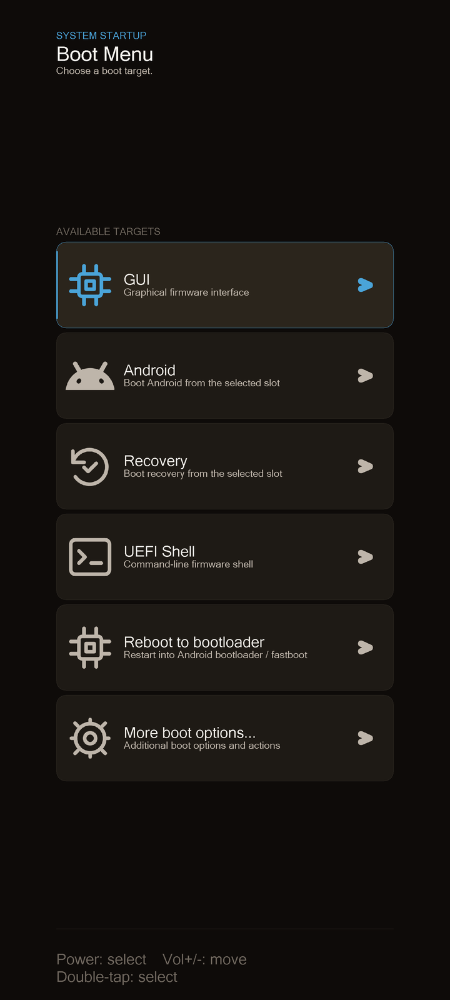
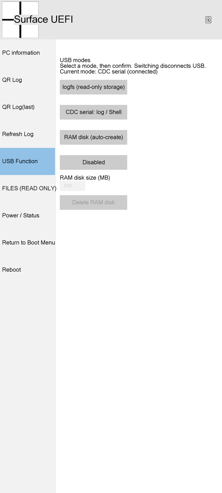
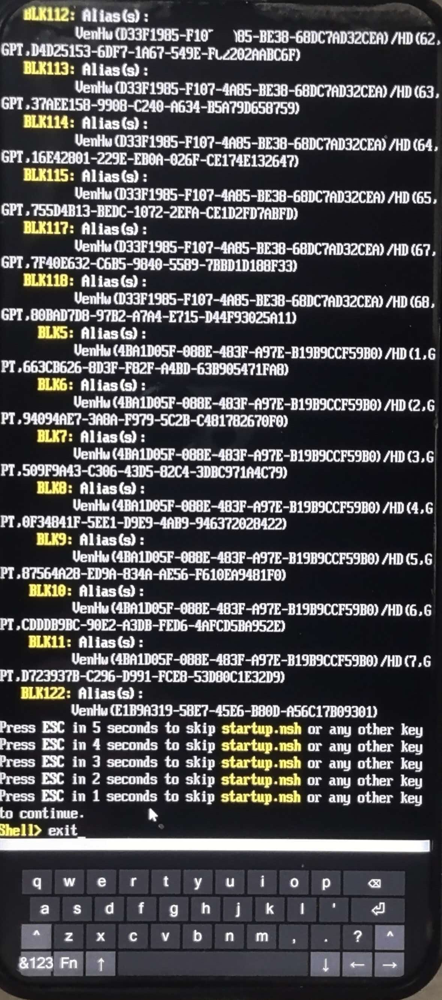

# mu_aloha_SM8650_shennong

[**中文**](README.md) | **English**

> **When borrowing from or using this project, please credit the source prominently in your own project.**
> See [Project Usage](#project-usage) for details.

**Project Mu** UEFI port for **Xiaomi 14 Pro** (shennong / SM8650): SM8650 overlay sources, one-click build scripts, bootable image, and test suite.

- Snapshot: branch `pre-touch`, HEAD `a00ac7d7` (b341, 2026-11-02)
- Image: `Build/ShennongPkg/xiaomi-shennong.img`, 2,711,552 bytes
  SHA256 `b6493bc626f7cde22f0381ab8211b94720d4598541bd47e8e8fc64f56832f501`
- Baseline: Project Mu Aloha `main`

## Screenshots

<table>
<tr>
<td></td>
<td></td>
</tr>
<tr>
<td align="center">Boot Menu — auto-enters GUI after 5 s of inactivity; can exit to Device Mode</td>
<td align="center">USB Function — four switchable modes</td>
</tr>
</table>


**UEFI Shell + On-Screen Keyboard** — block device list from `alias` output, with the soft keyboard at the bottom.

## Current Status

**Display** — Working
- 1440x3200 panel lit, frame-buffer console readable (sole output channel when no UART)
- Graphical UI (FrontPage) accessible: main menu, file browser, power status, USB, exit page
- Boot Menu shows first; auto-enters GUI after 5 s; key press or touch cancels the countdown

**Touch** — Working
- Full-screen touch input; GUI taps, bi-directional list scrolling, and on-screen keyboard (OSK) all functional
- Root cause was L12/IOVDD not being powered in UEFI; once powered, the chip responded immediately

**USB Device Mode (USB-CDC / Mass Storage)** — Working
- Host identifies device as `18D1:D00D` / Android Bootloader Interface; standard enumeration complete
- Four switchable modes: read-only logfs snapshot (USB mass storage), CDC serial (Python console), 512 MiB RAM disk, off
- On-device: COM20 interactive; Shell commands, log reads (174 KB / 1.5 s), full-screen screenshots (13 s) all work
- **Not** fastboot: no command interpreter, cannot flash

**Storage (UFS)** — Working
- 6 LUNs, 123 partitions, matching the stock GPT one-to-one
- Read-only: can browse FAT partitions and read files; write/erase always refused

**TZ / SMC** — Partial
- Normal SMC calls respond correctly; ShmBridge established
- Secure services not fully functional: feature TA signature verification fails (`ret=12`); Keymaster only reaches the loader

**Charging / Battery** — Partial
- Can read charger-connection state, battery-present flag, and interface-reported voltage
- **Cannot** control charging; does **not** show battery percentage or temperature (data source untrusted, no fake values)

**GPU** — Not implemented
- No 3D in UEFI phase; display uses 2D frame buffer, no GPU driver needed

**Audio** — Not implemented
- Speaker requires LPASS/TDM1 + amplifier chain; no playback stack on UEFI side

**Camera / Modem / PCIe / WLAN / NFC** — Not implemented


## One-Click Build

Linux / WSL:

```bash
./build.sh              # DEBUG (default)
./build.sh RELEASE      # release build
```

Windows (auto-delegates to WSL):

```bat
build.cmd
```

First run automatically:

1. Clones Project Mu Aloha baseline (default `~/mu_aloha_base`) and pulls submodules;
2. Lays down this repo's SM8650 overlay and applies patches to four submodules via `patches/`;
3. Creates a build tree on ext4 (default `~/mubuild-shennong`, avoiding slow `/mnt/*` 9p mounts);
4. Creates a Python venv (default `~/mu-venv-shennong`) and installs `pip-requirements.txt`;
5. Builds `xiaomi-shennong`, verifies logs and image, copies results back to `Build/ShennongPkg/`.

Optional environment variables: `MU_BASE`, `MU_BASE_REF`, `MU_WORK`, `MU_VENV`, `FORCE_INIT=1`.
Scripts do not depend on any absolute host path — place the repo anywhere and run directly.

Output:

```
Build/ShennongPkg/xiaomi-shennong.img   # for fastboot boot
```

## Device Tree Visualization

The following shows detailed project status:

**[Open devtree/examples/out/shennong.html](devtree/examples/out/shennong.html)**

<iframe src="devtree/examples/out/shennong.html" width="100%" height="640" style="border:1px solid #d0d7de;border-radius:8px"></iframe>

> Some Markdown previewers (including GitHub) do not render `iframe` for security reasons. If so, click the link above directly, or clone the repo and open `devtree/examples/out/shennong.html` in a browser.

Double-click to open in a local clone; it contains 107 nodes, 204 hard dependencies + 27 soft dependencies, 17 layout levels — searchable, filterable by status/group, clickable nodes with evidence chains, blocking chains, and address conflicts.

Current snapshot (`devtree/examples/shennong.state.yaml`, updated 2026-11-02 / b341):


## QR Log Reader

`tools/qr_camera_reader/` is a desktop GUI that uses a webcam to continuously decode QR-code boot logs scrolling on the firmware screen and stitch them together:

```bash
pip install -r tools/qr_camera_reader/requirements.txt
python tools/qr_camera_reader/qr_camera_reader.py --camera 0
```

Supports manual/auto exposure and metering lock (`--exposure`, `--auto-exposure`, `--no-meter`); decoded results can be copied and saved. Used for reading boot logs when no UART is available.

## Repository Contents

| Path | Contents |
|---|---|
| `Platforms/ShennongPkg/` | SM8650 / Xiaomi 14 Pro platform & device layer (DSC/FDF, DXE list, DTB, device blobs) |
| `Platforms/AndromedaPkg/` | FrontPage, QR log, DIAG, UfsPreDxe, ShmBridge stub and other porting changes |
| `Silicon/QC/Sm8650/` | QcomPkg (PlatformPeiLib shim, PlatformTheme, RFS, etc.) |
| `patches/` | Porting patches for four submodules (mu_basecore / mu_plus / mu_silicon_arm_tiano / surface_duo_binaries) |
| `scripts/` | `fastbuild.sh` (compat entry), `profile.sh`, `verify_usb_image.py`, `package_usb_variant.py`, etc. |
| `build_cfg/sm8650.json` | BootShim window (0xA7100000 / 4 MB) |
| `devtree/` | Device tree visualization: scripts, YAML data, single-file HTML |
| `tools/qr_camera_reader/` | QR code log reader |
| `Build/ShennongPkg/xiaomi-shennong.img` | Current bootable image |

This repo does **not** include the Project Mu common base tree, other device targets, other git branches, or analysis/extraction directories — those are prepared automatically by `build.sh`.

## Goal

Provide a bootable, UFS-readable, QR-log-capable, and **state-visualized** Project Mu base for **UniXNU / Hackios** development on Xiaomi 14 Pro (shennong / SM8650).

## Safety Constraints (from actual bring-up)

- Only `fastboot boot` for in-memory execution — **no partition writes**; Xiaomi 14 Pro has no unauthorized EDL, bricking requires disassembly or official repair.
- No disassembly, no UART — debugging is via USB / screen QR codes only.
- Crash recovery: long-press power button for 10–15 seconds.
- This image is for **Xiaomi 14 Pro / shennong** only; do not flash to other devices.

## Project Usage

**If you borrow from or use this project's code, patches, documentation, screenshots, or device-tree visualization data, please credit the source prominently in your own project.**

"Prominently" means visible when the project is opened, for example:
- A notice section at the top of the README or on the landing page
- A dedicated Credits / Acknowledgements section

Suggested wording:

> The SM8650 UEFI port in this project is based on / references the work of **mu_aloha_SM8650_shennong** (Xiaomi 14 Pro / shennong).

Only attribution is required — you are not obligated to open-source your modifications; please **do not** remove existing source attributions in this repo, and do not represent direct copies of this project's work as original. Commercial use and redistribution are equally subject to these terms.

## License & Disclaimer

Code inherits the licenses of Project Mu Aloha and its submodules (see [LICENSE](LICENSE)); third-party components follow their respective licenses.
This repo is provided "as is" for research and development purposes only, without any warranty. Use at your own risk.

## Acknowledgements

Every layer of this project builds on the work of the open-source community.

**Firmware Framework**
- [Project Mu](https://github.com/microsoft/mu) & [TianoCore EDK II](https://github.com/tianocore/edk2) — UEFI framework & build system
- [Project Mu Aloha](https://github.com/Project-Aloha/mu_aloha_platforms) — this project derives directly from its platform layer
- Microsoft `mu_basecore`, `mu_plus`, `mu_tiano_plus`, `mu_silicon_arm_tiano`,
  `mu_feature_config`, `mu_feature_dfci` — six base submodules
- [Xiaomi_Kernel_OpenSource-shennong](https://github.com/MiCode/Xiaomi_Kernel_OpenSource) —
  kernel implementations for eUSB2 repeater and DWC3 PHY
- Xiaomi SM8650 devicetree source — pin, regulator, and panel parameters
- [UniXNU](https://github.com/UniXNU) houji project — structural reference for the S3910 touch driver
- UEFI-For-OnePlus13R — also SM8650 / lanai; correct source for the FD window `0xA7100000`

**Toolchain**
- `tools/qr_camera_reader`: OpenCV, zxing-cpp, Pillow
- `devtree/`: Python 3.8+ & PyYAML; Graphviz required for SVG/PNG export

Copyrights of stock binaries belong to Qualcomm and Xiaomi; this repo only extracts and invokes them, and does not redistribute their source code.
